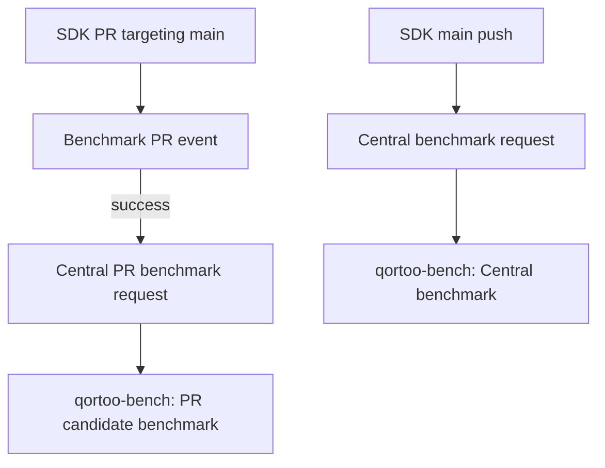

# Performance

Qortoo Bench owns Rust and Go benchmark workloads, measurement contracts,
execution, and result history. SDK repositories own product code, functional
tests, and native SDK/ABI validation.

## Workflow overview

SDK changes follow two paths. Names below match the workflows shown in Actions.
A PR can request candidate comparisons before merge and an official measurement
when it reaches `main`; these runs serve different purposes.

| Workflow | Trigger and output |
| --- | --- |
| [Central benchmark](../.github/workflows/benchmark.yml) | SDK main push or manual request. Successful official results are stored on `bench-data` and published on the [Performance page](https://qortoo.github.io/qortoo/docs/performance/). |
| [PR candidate benchmark](../.github/workflows/candidate.yml) | PR opened, reopened, or updated, after the SDK event workflow succeeds. Run titles start with `Candidate rust/go PR #…`. Base/head comparisons stay in the Actions summary and artifacts (30 days), without branch storage or official publication. |

SDK callers skip documentation-only and repository metadata changes according to
their workflow filters: [Rust](https://github.com/qortoo/qortoo-rs/blob/main/.github/workflows/benchmark.yml)
and [Go](https://github.com/qortoo/qortoo-go/blob/main/.github/workflows/benchmark.yml)
for main, [Rust PRs](https://github.com/qortoo/qortoo-rs/blob/main/.github/workflows/benchmark-pr.yml)
and [Go PRs](https://github.com/qortoo/qortoo-go/blob/main/.github/workflows/benchmark-pr.yml)
for candidates. PR filtering uses the full PR diff, so a documentation commit on
a PR that still includes code changes can request another comparison.
Fork PRs follow the source repository's Actions approval policy.

## Run and inspect

Use the [local run instructions](../README.md#run-full-measurements),
[official workflow guide](central-workflow.md), or [PR comparison guide](pr-candidates.md).
The workflow guides cover source selection, credentials, results, and recovery.
Main requests retain the exact push SHA; PR comparisons retain the selected
base/head revisions. Local uncommitted SDK changes are not measurement inputs.

## Interpret results

Rust/Go latency differences describe complete public API paths, including
serialization and runtime work; they do not isolate cgo overhead. Compare trends
only within matching contracts, toolchains, and environments. Smoke runs check
execution and correctness, not performance. This harness does not measure heap
allocations.

| Guide | Details |
| --- | --- |
| [Results](results.md) | Input identity, samples, and interpretation |
| [Result publishing](result-publishing.md) | Metrics, series, provenance, and publication |
| [Counter](counter-measurement.md) and [Variable](variable-measurement.md) | Workloads and timing contracts |
